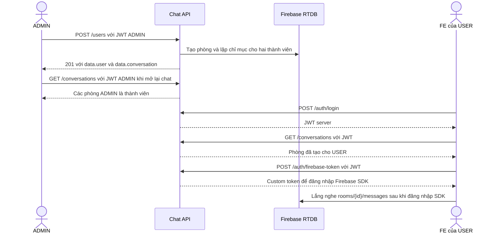

# Chat Backend

Backend Express + TypeScript cho Chatapp. MongoDB lưu tài khoản, Firebase Realtime Database (RTDB) lưu phòng và tin nhắn, Firebase Cloud Messaging (FCM) gửi Web Push.

**Kiến trúc chat** — BE quản lý phòng, thành viên, toàn bộ thao tác ghi và gửi push. Theo thiết kế này, FE đăng nhập bằng server và đọc trực tiếp tin của phòng đang mở từ Firebase Realtime Database. Đã triển khai API phòng, custom token chỉ đọc và ghi/push bằng JWT server. Cần cấu hình Firebase Admin và Rules đúng project để dùng trên cloud. Xem [luồng hiện tại, hợp đồng API và thứ tự tích hợp cho FE](#tích-hợp-chat-notification-và-pwa).

## Khởi chạy

Yêu cầu Node.js >= 22, npm và MongoDB.

```sh
npm ci
cp -n .env.example .env
# Cấu hình MONGODB_URI và JWT_SECRET trong .env.
npm run dev
```

Database mặc định: `mongodb://127.0.0.1:27017/chat`. Cổng mặc định: `3615`.

```sh
npm run check
npm run build
npm start
```

## CI/CD cho backend

GitHub Actions chạy `npm ci`, `npm run check` và `npm run build` trên Node.js 22 cho pull request vào `master`. Khi push lên `master`, job deploy chuyển bản build đã kiểm tra sang máy Linux qua SSH và khởi động ứng dụng PM2 `chat-be`. Có thể chạy lại từ **Actions → Chat BE CI/CD → Run workflow → master**. [Xem workflow](.github/workflows/ci-cd.yml).

**Chuẩn bị máy chủ một lần**

1. Cài Node.js 22 trở lên, npm, PM2, Bash và curl cho tài khoản SSH. Nếu dùng nvm và lệnh chưa có trong PATH của phiên SSH không tương tác, script thử nạp nvm từ thư mục của tài khoản đó. Trên Linux, script kiểm tra tiến trình PM2 qua `/proc`. Khi môi trường không có `/proc`, script dùng `lsof`.
2. Cấp quyền ghi `/var/www/chat-be` cho tài khoản triển khai hoặc quyền tạo thư mục này trong `/var/www`. Pipeline tạo `releases`, quản lý symlink `current` và tiến trình PM2 `chat-be`. Nếu đang chạy ứng dụng cùng tên bằng cách khác, lên lịch chuyển giao tiến trình trước lần deploy đầu tiên.
3. Nếu dùng service account JSON, lưu file trên máy chủ, ví dụ `/var/www/chat-be/shared/firebase-adminsdk.json`. Cấp quyền đọc cho tài khoản PM2 và điền đường dẫn tuyệt đối đó vào biến `GOOGLE_APPLICATION_CREDENTIALS`. Nếu máy chủ đã được cấp Application Default Credentials (ADC), để biến này trống.
4. Trỏ reverse proxy tới cổng trong biến `PORT` (mặc định `3615`). Cấu hình `pm2 startup` cho tài khoản triển khai nếu PM2 cần tự khởi động cùng máy chủ. Workflow chạy `pm2 save` sau khi kiểm tra HTTP thành công.

**Cấu hình GitHub** trong **Settings → Environments → production**, hoặc dùng secrets và variables cấp repository.

| Tên               | Loại     | Giá trị                                                                                                                                        |
| ----------------- | -------- | ---------------------------------------------------------------------------------------------------------------------------------------------- |
| `SERVER_IP`       | Secret   | IP hoặc hostname của máy chủ SSH                                                                                                               |
| `SERVER_PASSWORD` | Secret   | Mật khẩu SSH của tài khoản triển khai                                                                                                          |
| `SERVER_USER`     | Variable | Tùy chọn. Tài khoản SSH sở hữu thư mục triển khai và tiến trình PM2. Mặc định `root`. Workflow cũng đọc Secret cùng tên nếu Variable để trống. |
| `SERVER_PORT`     | Variable | Cổng SSH, mặc định `22`                                                                                                                        |

Runner dùng `StrictHostKeyChecking=accept-new` và tin khóa máy chủ ở lần kết nối đầu tiên. Mỗi job deploy dùng runner mới nên khóa được ghi lại trong từng job.

Khai báo các biến ứng dụng dưới đây cùng với cấu hình SSH. Workflow tạo `.env` riêng cho mỗi release từ các biến này và chuyển qua SSH với quyền `600`. Artifact trên GitHub chỉ chứa bản build và `.env.example`.

| Tên                              | Loại     | Giá trị                                                                                                                                      |
| -------------------------------- | -------- | -------------------------------------------------------------------------------------------------------------------------------------------- |
| `NODE_ENV`                       | Workflow | Luôn là `production`.                                                                                                                        |
| `MONGODB_URI`                    | Secret   | Bắt buộc. Chuỗi kết nối MongoDB production.                                                                                                  |
| `JWT_SECRET`                     | Secret   | Bắt buộc. Dùng giá trị backend đang dùng nếu cần giữ phiên đăng nhập khi nâng cấp.                                                           |
| `FIREBASE_PROJECT_ID`            | Variable | Bắt buộc. Project ID phải khớp Firebase Web App của FE.                                                                                      |
| `FIREBASE_DATABASE_URL`          | Variable | Bắt buộc. URL gốc của Firebase Realtime Database.                                                                                            |
| `GOOGLE_APPLICATION_CREDENTIALS` | Variable | Đường dẫn tuyệt đối tới JSON credentials trên máy chủ. Để trống khi dùng ADC.                                                                |
| `PWA_BASE_URL`                   | Variable | Bắt buộc. Origin HTTPS của FE, ví dụ `https://chat.example.com`.                                                                             |
| `PORT`                           | Variable | Cổng BE, mặc định `3615`.                                                                                                                    |
| `TRUST_PROXY`                    | Variable | Số reverse proxy Express tin cậy, mặc định `1`.                                                                                              |
| `BODY_LIMIT`                     | Variable | Kích thước request tối đa, mặc định `10mb`.                                                                                                  |
| `CORS_ORIGINS`                   | Variable | Danh sách origin, phân cách bằng dấu phẩy. Mặc định `*`. Khi FE gọi API khác origin, khai báo origin FE để request có credentials hoạt động. |
| `CORS_MAX_AGE`                   | Variable | Thời gian cache CORS preflight, mặc định `86400` giây.                                                                                       |
| `SESSION_COOKIE_SAME_SITE`       | Variable | Mặc định `lax`. Dùng `none` khi FE và BE khác site và đều dùng HTTPS.                                                                        |
| `JWT_SALT_ROUNDS`                | Variable | Số vòng bcrypt, mặc định `10`.                                                                                                               |
| `SHUTDOWN_TIMEOUT_MS`            | Variable | Thời gian chờ tắt server, mặc định `60000` ms.                                                                                               |
| `PUBLIC_URL`                     | Variable | URL công khai của backend. Có thể để trống.                                                                                                  |
| `SWAGGER_SERVER`                 | Variable | URL backend ưu tiên trong Swagger. Khi trống, dùng `PUBLIC_URL` nếu đã đặt.                                                                  |
| `LOG_LEVEL`                      | Variable | Mức log production, mặc định `info`.                                                                                                         |
| `PUSH_TIMEOUT_MS`                | Variable | Thời gian chờ gửi push, mặc định `5000` ms.                                                                                                  |

Khi chuyển từ cấu hình `shared/.env` sang workflow này, nhập giá trị production hiện tại vào GitHub trước lần deploy đầu tiên. Cấu hình VAPID và các biến `VITE_*` được thiết lập trong CI/CD của frontend.

Script cài dependency production, kiểm tra cấu hình Firebase, URL PWA và kết nối MongoDB trước khi chuyển phiên bản. Sau đó, script xác nhận PM2 chạy đúng release và gọi được `/docs/swagger.json` qua loopback. Nếu khởi động hoặc kiểm tra HTTP thất bại, workflow báo lỗi và quay lại release trước cùng file cấu hình của release đó. Máy chủ giữ bản hiện tại, bản ngay trước đó và dọn các release cũ hơn một tuần. [Script triển khai](deploy/activate.sh).

Khi job deploy thất bại, xem dòng lỗi sau `SSH connected` trong GitHub Actions. Các bước tạo thư mục, giải nén, kiểm tra công cụ, cài dependency và kiểm tra HTTP đều có tên riêng trong log. Nếu PM2 khởi động nhưng API chưa trả lời, xem log trên máy chủ bằng `pm2 logs chat-be --lines 50 --nostream`.

### Nginx cho `chat-app-api.ncjscs.com`

Workflow triển khai vào `/var/www/chat-be/releases` rồi đổi symlink `current`. PM2 chạy `/var/www/chat-be/current/dist/server.js` với cổng `3615` mặc định. Nginx chuyển các request API và Swagger của domain này tới Express.

Đặt cấu hình sau trên máy chủ. Nếu vhost đã có TLS, giữ các directive `listen` và chứng chỉ hiện tại trong cùng khối `server`. Nếu đổi `PORT` trong GitHub, cập nhật cổng tương ứng trong `proxy_pass`.

```nginx
server {
    server_name chat-app-api.ncjscs.com;
    client_max_body_size 10m;

    location / {
        proxy_pass http://127.0.0.1:3615;
        proxy_http_version 1.1;
        proxy_set_header Host $host;
        proxy_set_header X-Forwarded-Proto $scheme;
        proxy_set_header X-Forwarded-For $proxy_add_x_forwarded_for;
    }
}
```

Khi HTTPS đã hoạt động, đặt `PUBLIC_URL=https://chat-app-api.ncjscs.com` ở CI/CD của BE và `VITE_API_BASE_URL=https://chat-app-api.ncjscs.com/api/v1` ở CI/CD của FE. `CORS_ORIGINS` và `PWA_BASE_URL` của BE dùng origin HTTPS mà người dùng mở frontend.

## Kiến trúc

```text
src/
  app.ts               # Express, middleware, database, router
  server.ts            # HTTP server và graceful shutdown
  configs/             # Environment, JWT, Firebase Admin, Swagger
  constants/           # Role, mã lỗi, thông điệp phản hồi
  controllers/         # HTTP auth, users, chat và thiết bị push
  db/                  # Kết nối MongoDB
  helpers/             # Tiện ích kết nối database
  middlewares/         # JWT, kiểm tra quyền, validation, lỗi, request logger
  models/              # AppSchema, User
  openapi/             # Tài liệu Auth, Users, Chat, Push
  repositories/        # MongoDB user, RTDB chat và push registry
  routes/v1/auth/      # Router auth
  routes/swagger/      # Swagger UI và swagger.json
  services/            # Auth, lưu tin và push best-effort
  types/               # Kiểu dữ liệu dùng chung và auth
  utils/               # Mật khẩu, JWT, phản hồi, logger, repository helpers
```

Luồng xử lý: route → validation → controller → service → repository → model.
Giữ alias `src/*`, định dạng phản hồi, cấu hình lint/format và base repository của dự án nguồn.
Không sao chép `.env`, dữ liệu, lịch sử Git hay cấu hình triển khai của dự án nguồn.

## API

Base URL: `http://localhost:3615/api/v1`.

| Method | Endpoint         | Body / xác thực                                  |
| ------ | ---------------- | ------------------------------------------------ |
| POST   | `/auth/register` | JWT ADMIN và `name`, `email`, `password`, `code` |
| POST   | `/auth/login`    | `email`, `password`                              |
| GET    | `/auth/me`       | `Authorization: Bearer <accessToken>`            |

Chỉ ADMIN đang hoạt động được tạo tài khoản. `POST /auth/register` yêu cầu JWT của ADMIN và luôn tạo USER. Cả endpoint này và `POST /users` với role USER đều tạo phòng 1–1 giữa USER mới và ADMIN gửi request, rồi trả `201` với `data.user` và `data.conversation`. Tạo thêm ADMIN trả `data.user`.
Role là enum `ADMIN | USER`, được lưu trực tiếp tại trường `Users.role`, mặc định `USER`. Không có model hoặc collection riêng cho role.
ADMIN đầu tiên được tạo qua `POST /auth/register-admin` không cần JWT. ADMIN tiếp theo được tạo bởi ADMIN đang đăng nhập qua `POST /users/admin`.
Thông tin user trong response đăng ký, đăng nhập và `/auth/me` dùng trường `role`.
Model, đăng nhập và JWT đều kiểm tra giới hạn hai role này. Tài khoản hoặc token dùng role khác bị từ chối.
Mật khẩu đăng ký dài 8–128 ký tự. Email được chuẩn hóa thành chữ thường.
Login trả về `user` và `tokens`. Cả `accessToken` và `refreshToken` của server có hiệu lực **365 ngày kể từ lúc cấp**. FE dùng `accessToken` làm Bearer cho REST. Token đã cấp giữ thời hạn trong claim `exp`; đăng nhập lại để nhận thời hạn mới. API có `GET /auth/session` để khôi phục cookie HttpOnly và `POST /auth/logout` để xóa cookie. Chưa có endpoint refresh/revoke JWT.

Trên localhost, mở [Swagger tạo tài khoản](http://localhost:3615/docs/#/Users/createManagedUser) hoặc [Swagger mở phòng](http://localhost:3615/docs/#/Chat/openUserRoom). Để thử API, đăng nhập qua `POST /auth/login` và nhập `data.tokens.accessToken` của ADMIN vào **Authorize**. FE có thể xem [hợp đồng chat](http://localhost:3615/docs/chat-contract/) hoặc tải [OpenAPI JSON](http://localhost:3615/docs/swagger.json).

Ví dụ ADMIN tạo USER và phòng riêng:

```sh
curl -X POST http://localhost:3615/api/v1/auth/register \
  -H 'Authorization: Bearer <ADMIN_ACCESS_TOKEN>' \
  -H 'Content-Type: application/json' \
  -d '{"name":"Demo","email":"demo@example.com","password":"example-password","code":"DEMO001"}'
```

Response thành công: `{ success, statusCode, message, data }`.
Response lỗi: `{ success: false, statusCode, errorCode, message }`.

Production yêu cầu cấu hình `MONGODB_URI` và `JWT_SECRET`. Các tùy chọn còn lại nằm trong `.env.example`.

## Tích hợp chat, notification và PWA

BE quản lý room/thành viên, ghi tin, cập nhật preview/index và gửi FCM. FE chỉ đọc `rooms/{id}/messages` bằng RTDB listener. Mọi REST API cần xác thực đều dùng **JWT server**; Firebase ID token không được dùng làm Bearer token cho REST.

| Method       | Path sau /api/v1            | Body / data                                                          |
| ------------ | --------------------------- | -------------------------------------------------------------------- |
| POST         | /auth/firebase-token        | JWT, không body → `{ customToken }`, claim chatRead=true             |
| GET          | /chat/people?email=…        | JWT → `{ person: { id, displayName }                                 | null }` |
| POST         | /conversations              | JWT ADMIN, `{ participantIds: [userId] }` → `{ conversation }`       |
| GET          | /conversations              | JWT → `{ conversations }` của tài khoản hiện tại                     |
| POST         | /conversations/:id/messages | JWT, `{ clientMessageId, text }` → `{ message, duplicate }`          |
| PUT / DELETE | /push/devices/:id           | JWT; PUT `{ token }`, DELETE không body → `{ deviceId, registered }` |

Tìm người trả Mongo ID dùng trong participantIds. BE kiểm tra lại tài khoản đang hoạt động cho từng request, tự thêm người tạo vào room và ánh xạ UID chat. Room trả `id, title, memberIds, members, createdBy, createdAt, updatedAt, lastMessage, lastMessageId, lastSenderId`; memberIds/senderId là UID chat do BE quản lý.

Mỗi USER mới có một phòng với ADMIN tạo tài khoản. Nếu đang nâng cấp một USER cũ chưa có phòng, ADMIN có thể gọi `POST /conversations` với đúng một Mongo ID của USER đó. Cùng ADMIN gọi lại sẽ nhận phòng hiện có cùng lịch sử. Một ADMIN khác gọi sẽ nhận `409 USER_ROOM_ALREADY_ASSIGNED`. Tài khoản cũ đã thuộc nhiều phòng cần được xử lý dữ liệu riêng trước khi áp dụng mô hình một phòng.

Backend dành trước email và mã tài khoản trong MongoDB và chỉ kích hoạt USER khi đã ghi phòng và cả hai chỉ mục thành viên vào RTDB. Nếu request lỗi giữa chừng, cùng ADMIN gửi lại yêu cầu tạo với cùng email, mã, tên và mật khẩu để hoàn tất. USER đang chờ chưa thể đăng nhập. Sau khi đã hoàn tất, tạo lại tài khoản trùng trả `409`.

### Lấy phòng khi mở màn hình chat

Cả ADMIN và USER gọi `GET /api/v1/conversations` với access token của **chính tài khoản đang đăng nhập**. BE tra phòng theo UID chat của người gọi và trả danh sách theo `updatedAt` mới nhất trước. [Thử GET /conversations trong Swagger](http://localhost:3615/docs/#/Chat/listMyConversations).

```sh
curl http://localhost:3615/api/v1/conversations \
  -H "Authorization: Bearer $ACCESS_TOKEN"
```

- **ADMIN** chọn một phòng từ `data.conversations`. Ngay khi vừa tạo USER, ADMIN cũng có thể mở thẳng `data.conversation.id` trong response `201`.
- **USER** mở `data.conversations[0].id` khi danh sách có đúng một phòng. Nếu danh sách rỗng, hiển thị “Chưa có phòng” và chờ ADMIN cấp phòng.
- **Khi đã chọn phòng**, FE gọi `POST /auth/firebase-token` bằng JWT server, dùng `data.customToken` để đăng nhập Firebase SDK và gắn listener tại `rooms/{id}/messages`. Khi quay lại màn hình chat hoặc cần làm mới danh sách, gọi lại `GET /conversations`.



Gửi tin trim text 1–4000 ký tự, transaction kiểm tra membership và idempotency. Lần đầu 201; cùng room/người gửi/ID/nội dung trả 200 duplicate=true, không gửi push lại. Cùng ID khác nội dung/người gửi trả 409 IDEMPOTENCY_CONFLICT. FCM best-effort sau commit; response thành công xác nhận lưu tin, không xác nhận người nhận đã đọc.

### Phiên đọc Firebase và danh tính

`POST /auth/firebase-token` chỉ nhận danh tính từ JWT đã xác minh và MongoDB, không nhận UID từ client. Custom token có `chatRead: true`. FE dùng signInWithCustomToken/inMemoryPersistence với cùng Firebase project/database, giữ phiên này khi đổi room; unsubscribe/signOut khi logout hoặc đổi tài khoản.

UID mặc định là chuỗi Mongo _id. Tài khoản có lịch sử Firebase cũ có thể được quản trị viên ánh xạ bằng field **firebaseUid** trong MongoDB, có unique sparse index, select:false và không được public API nhận hoặc trả. Không tự nối UID theo email. BE chặn mapping trùng identity của tài khoản khác. Cần xác minh/hoàn tất mapping trước lần tạo room mới; tác vụ này không di chuyển lịch sử.

JWT server và phiên Firebase có vòng đời riêng. Đổi mật khẩu/xóa tài khoản MongoDB chặn REST/token mới nhưng chưa tự thu hồi Firebase ID token đang có. Nếu cần khóa quyền đọc ngay, cần thêm cơ chế revoke/registry được Rules kiểm tra.

### Cấu hình để chạy với Firebase thật

```dotenv
FIREBASE_PROJECT_ID=<cùng project của FE>
FIREBASE_DATABASE_URL=https://<database-url-do-Firebase-cung-cap>
GOOGLE_APPLICATION_CREDENTIALS=/duong-dan-ngoai-repo/service-account.json
PWA_BASE_URL=https://<origin-FE>
```

Credentials Admin cần ký custom token, truy cập RTDB và FCM. Khi GOOGLE_APPLICATION_CREDENTIALS trỏ tới service account JSON, BE dùng cert(file) để ký trực tiếp, không yêu cầu IAM Credentials API. Nếu dùng ADC managed, cần quyền/API IAM tương ứng. Chỉ lưu đường dẫn trong .env được Git ignore; không chép file private key hoặc server secret vào FE/VITE_*.

Tại FE dùng VITE_API_BASE_URL gồm /api/v1, điền Firebase Web App config cùng project/database. Chat bật mặc định, có thể đặt VITE_CHAT_API_ENABLED=false để tạm tắt. VAPID/sender ID chỉ cần cho push. Cấu hình CORS cho origin FE, Content-Type và Authorization; production dùng HTTPS và reverse proxy API trước SPA fallback.

### RTDB Rules và FE listener

FE đọc query `rooms/<id>/messages`, orderByChild createdAt, limitToLast 100. Không có GET messages HTTP. Metadata/danh bạ do BE cung cấp; mọi ghi dữ liệu chỉ qua Admin SDK.

File `../chatapp/database.rules.json` là Rules mục tiêu: root deny read/write, chỉ thành viên có claim chatRead đọc nhánh messages. Deploy sau khi kiểm tra môi trường thật; Rules mới chặn các client cũ còn tạo room/ghi trực tiếp. Code backend không tự deploy Rules.

### Kiểm tra cục bộ

Typecheck/lint/build đã đạt. Kiểm tra HTTP + Firebase Auth/RTDB Emulator thật với MongoDB riêng đã xác nhận: custom token/mapping UID, room/index, danh sách theo membership, BE ghi → FE listener, retry/conflict, device PUT/DELETE, người ngoài phòng không đọc/gửi được, thành viên không ghi trực tiếp hoặc đọc metadata RTDB. Không thêm/sửa unit test.

UI cũng đã được kiểm tra trên Firebase cloud thật, không mock API/SDK: đăng nhập, cấp phiên đọc, nhận/gửi tin hai chiều, tạo room từ UI, đổi room và logout đều đạt. Rules chỉ đọc cho thành viên đã được áp dụng và kiểm tra trên cloud: ngoài phòng/ẩn danh/ghi client đều bị từ chối. Dữ liệu review được dọn riêng. FCM delivery trên thiết bị thật chưa được nghiệm thu. Trước rollout cần kiểm tra hai tài khoản trên môi trường thật, push khi đóng tab, click deep link, logout và đổi tài khoản. Xem [chi tiết chat/push](docs/chat-push.md).

## CRUD users

Quản lý tài khoản MongoDB qua JWT server từ `/auth/login`. Tất cả endpoint `/users` yêu cầu ADMIN; backend đọc lại tài khoản hiện tại trong database để kiểm tra quyền, từ chối JWT của tài khoản đã xóa hoặc bị hạ quyền. `/auth/me` tra theo userId nên vẫn hoạt động sau khi đổi email.

| Method | Endpoint            | Chức năng                                 |
| ------ | ------------------- | ----------------------------------------- |
| POST   | `/api/v1/users`     | Tạo tài khoản USER hoặc ADMIN             |
| GET    | `/api/v1/users`     | Danh sách, phân trang, tìm kiếm, lọc role |
| GET    | `/api/v1/users/:id` | Chi tiết tài khoản                        |
| PATCH  | `/api/v1/users/:id` | Cập nhật các field được gửi               |
| DELETE | `/api/v1/users/:id` | Xóa vĩnh viễn tài khoản MongoDB           |

Ví dụ body tạo user:

```json
{
  "name": "Nguyen Van A",
  "email": "user@example.com",
  "password": "example-password",
  "code": "USER001",
  "role": "USER"
}
```

`name`, `email`, `password`, `code` bắt buộc khi tạo. `role` là enum ADMIN/USER, mặc định USER. PATCH nhận một hoặc nhiều trong năm field trên; password mới được bcrypt hash, không có trong response. Không nhận `_id`, `deletedAt`, timestamp hoặc field ngoài schema. ID phải là Mongo ObjectId 24 ký tự hex. Email được chuẩn hóa chữ thường; email/code trùng trả 409. Không được tự xóa tài khoản hoặc tự hạ quyền ADMIN của mình.

Ví dụ list: `GET /api/v1/users?page=1&limit=20&search=nguyen&role=USER`. `limit` tối đa 100; tìm kiếm chuỗi literal theo name/email/code; sắp xếp tài khoản mới nhất trước. Response data: `{ paginate: { page, limit, total, totalPages }, results: [...] }`. Tạo USER trả `{ user, conversation }`. Tạo ADMIN, get và update trả `{ user }`. Delete trả `{ id, deleted: true }`. User không tồn tại trả 404; input sai trả 422; USER truy cập trả 403.

## API tạo ADMIN

`POST /api/v1/users/admin` yêu cầu JWT của ADMIN đang hoạt động. Backend luôn gán role `ADMIN`; body chỉ nhận `name`, `email`, `password`, `code`, không gửi `role`.

```sh
curl -X POST http://localhost:3615/api/v1/users/admin \
  -H 'Authorization: Bearer <ADMIN_ACCESS_TOKEN>' \
  -H 'Content-Type: application/json' \
  -d '{"name":"Admin","email":"admin@example.com","password":"example-password","code":"ADMIN002"}'
```

Thành công trả 201 với `data.user.role = ADMIN`, không trả password. Email/code trùng trả 409; body không hợp lệ trả 422; chưa đăng nhập trả 401; tài khoản USER trả 403. Endpoint dùng chung kiểm tra quyền hiện tại, hash mật khẩu và xử lý lỗi với CRUD users.

## Đăng ký ADMIN đầu tiên

`POST /api/v1/auth/register-admin` không cần Authorization. Body chỉ nhận `name`, `email`, `password`, `code`; backend gán role ADMIN, hash mật khẩu và không trả password hoặc cờ bootstrap.

```sh
curl -X POST http://localhost:3615/api/v1/auth/register-admin \
  -H 'Content-Type: application/json' \
  -d '{"name":"First Admin","email":"admin@example.com","password":"example-password","code":"ADMIN001"}'
```

Thành công trả 201 với `data.user`. Sau đó dùng `/auth/login` để lấy JWT. Khi đã có tài khoản ADMIN hoặc bản ghi đánh dấu bootstrap còn tồn tại, API trả 409 với `errorCode: INITIAL_ADMIN_ALREADY_EXISTS`. Các ADMIN tiếp theo dùng API `/users/admin` yêu cầu JWT ADMIN.

Ràng buộc unique partial index `initial_admin_unique` trên cờ nội bộ `initialAdmin=true` đảm bảo nhiều request đăng ký đồng thời chỉ có một request tạo ADMIN thành công. Index được chờ tạo xong trước lần insert; không chỉ kiểm tra tồn tại rồi ghi. Cờ không được nhận từ request và không có trong response. Nếu validation hoặc insert thất bại thì không ghi cờ riêng làm khóa quá trình đăng ký. Không xóa hoặc reset cờ/bản ghi bootstrap khi thao tác trực tiếp database nếu muốn giữ trạng thái khởi tạo.

## Giữ đăng nhập qua cookie HttpOnly

POST /auth/login đặt cookie chatapp_session host-only, HttpOnly, path /api/v1/auth, SameSite=Lax mặc định; Secure khi HTTPS/production. Cookie hết hạn cùng access token (hiện 365 ngày). FE gửi credentials: include cho login/session/logout; JS chỉ giữ access token trong bộ nhớ, không localStorage/sessionStorage.

GET /api/v1/auth/session không nhận Bearer: đọc cookie, kiểm tra chữ ký/hạn/tokenUse access và tài khoản MongoDB, trả data { user, tokens: { accessToken } }. Không có/hết phiên trả 401 và xóa cookie; lỗi hạ tầng không xóa cookie. Restore không gia hạn token. POST /api/v1/auth/logout không cần Bearer, xóa cookie và trả data { loggedOut: true }. Không thu hồi JWT đã sao chép, browser khác hoặc Firebase session; FE cleanup listener/Firebase/push riêng.

Ba endpoint cookie kiểm tra Origin độc lập với CORS chung; wildcard * không cho phép origin tùy ý. Khi FE/API khác origin, cấu hình PWA_BASE_URL hoặc CORS_ORIGINS đúng origin FE. Vite proxy/production proxy giữ Host FE và X-Forwarded-Proto đúng. Khi khác site, cấu hình SESSION_COOKIE_SAME_SITE=none và HTTPS; CORS phải có credentials, browser có thể chặn third-party cookie. Không đổi JWT_SECRET nếu muốn giữ token hiện có.

Kiểm tra phiên đăng nhập bằng HTTP thật, MongoDB riêng và Chrome qua Vite proxy đã đạt: hạn/flags cookie, Origin không tin cậy bị chặn, token hết hạn/refresh bị từ chối, reload và khởi động lại Chrome vẫn giữ đăng nhập, logout xóa cookie và reload vẫn ở login. Không có password/JWT trong Web Storage hoặc runtime exception. Kiểm tra này tắt chat, chưa chạy lại Firebase/push. Lint/build FE/BE đạt; không thêm/sửa unit test.
